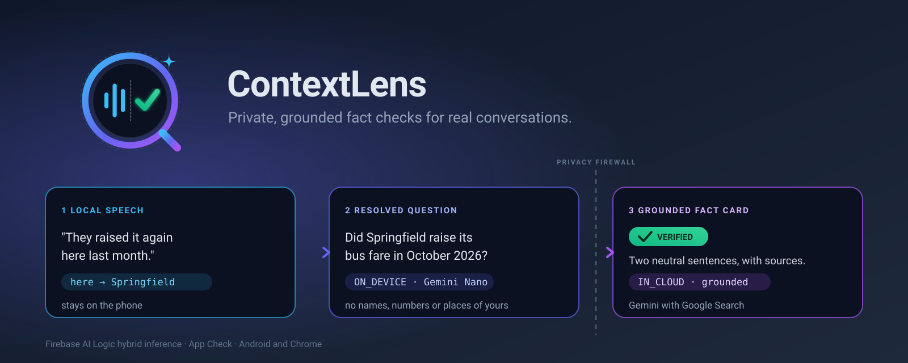

# ContextLens



**Private, grounded fact checks for real conversations.**

ContextLens is an Android app that listens to a conversation and checks the factual claims in it, without sending the conversation anywhere. Gemini Nano on the phone decides which sentences are checkable claims, resolves words like "here", "they" and "last month" against a private session context, and rewrites each claim into one self-contained question with no personal data. Only that question goes to cloud Gemini, grounded with Google Search, which returns a short verdict with its sources.

It is built for the [Firebase Hybrid AI Hackathon 2026](https://firebasehybridaihackathon.devpost.com/) on **Firebase AI Logic** hybrid inference: **Gemini Nano on the device** for the private part, **cloud Gemini with Grounding with Google Search** for verification. Every result shows where it ran, as reported by the SDK, and an egress ledger lists every request that left the phone.

Web companion: **https://nikolareljin.github.io/context-lens/** · Documentation: **https://nikolareljin.github.io/context-lens/docs/**

> Status: in development. The record of what is built, and when, is in [docs/implementation-progress.md](docs/implementation-progress.md).

## How it works

| Step | Where it runs |
|---|---|
| Speech to text (or typed input) | on the phone, offline speech recognition |
| Small talk filtered by simple rules | on the phone |
| Claim detection, reference resolution, rewrite without personal data | Gemini Nano on the phone (Strict mode: on device only) |
| Personal-data check on the rewritten question; the request is withheld on a match | on the phone, deterministic rules |
| Verification with sources | cloud Gemini with Grounding with Google Search, receiving only the rewritten question |

Two privacy modes:

- **Strict** (default when the phone supports Gemini Nano): the gatekeeper runs only on the device. If the model is not available, nothing is sent and only the local rules filter.
- **Balanced** (opt in): the gatekeeper prefers the device and may fall back to the cloud. The app says so before you turn it on.

The app has no shared backend. The cloud check runs in a Firebase project you connect in Settings, on your own quota and bill; without one, everything stays on the phone. See [Connect your own Firebase project](https://nikolareljin.github.io/context-lens/docs/own-project/).

## Platforms

| Platform | State |
|---|---|
| Android | in development; minSdk 26; on-device inference needs a phone with Gemini Nano support |

## Repository layout

| Path | Contents |
|---|---|
| `apps/android/` | Kotlin, Jetpack Compose app (added with the first app milestone) |
| `firebase/` | Firebase configuration templates (added with the Firebase milestones) |
| `scripts/` | build, test, release and deploy scripts behind `./dev` |
| `docs/` | documentation site, decisions, evaluation, progress log |

## Build and test

Requirements: JDK 17, Android SDK (platform 35+), Git, Bash.

```bash
./dev setup --check   # report what is missing
./dev cloud           # sign in and set up the Firebase backend (asks, opens the browser)
./dev phone           # pair a phone by QR code and register its App Check token
./dev build           # debug APK
./dev test            # unit tests and script tests
./dev lint            # Android lint, shellcheck
./dev install         # install the debug APK on a connected phone
```

Firebase configuration (`google-services.json`) is not part of the repository; see the [setup page](docs/setup.md).

## Install on a phone


Scan the code with the phone's camera, or open
`https://github.com/nikolareljin/context-lens/releases/latest/download/context-lens.apk` on the phone,
to download the newest release's APK. Allow installs from that source when Android asks.
Over a USB cable with USB debugging on: `bash scripts/phone-install.sh` (Linux, macOS, WSL; no SDK needed).
Details: [Download](https://nikolareljin.github.io/context-lens/docs/download/).

## Releases

Every release (`x.y.z`) builds a signed APK and attaches it to the GitHub release, once as
`contextlens-x.y.z.apk` and once as `context-lens.apk`, the fixed name the QR code points to.

## License

[Apache License 2.0](LICENSE). Created by Nik Reljin.
