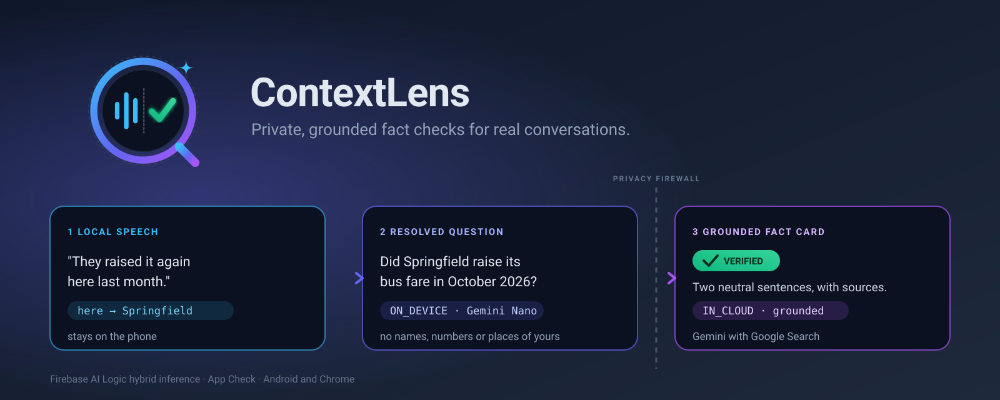

# ContextLens

<strong>Private, grounded fact checks for real conversations.</strong> The phone decides which sentences are checkable claims and rewrites them without personal data; only that clean question goes to the cloud for a sourced verdict.

AndroidFirebase AI LogicGemini Nano on deviceGrounding with Google SearchApp Check

!!! info "Status"
    In development for the [Firebase Hybrid AI Hackathon 2026](https://firebasehybridaihackathon.devpost.com/). What exists today, and when it was built, is in the [progress log](implementation-progress.md).

## The problem

Checking what is said in a meeting, a lecture or a conversation usually means sending the whole conversation to a server. Most of it is small talk, and the rest is full of names, places and phone numbers that do not need to leave the room.

## Three stages

| Stage | What happens | Where |
|---|---|---|
| 1. Local speech | the sentence, its resolved references ("here → Springfield") | on the phone |
| 2. Resolved question | one self-contained question without personal data | Gemini Nano on the phone |
| 3. Fact card | verdict, two neutral sentences, sources | cloud Gemini, grounded with Google Search |

Each card shows the source Firebase AI Logic reported for that request (on device or in cloud) and how long it took. See [how the hybrid split works](hybrid.md) and the [privacy firewall](privacy.md).

## Get it

In Chrome: the [web companion](../) runs the same three stages in the browser.

Scan with an Android phone to download the newest APK, or see [Download](download.md) for installing over USB.

- Source: [github.com/nikolareljin/context-lens](https://github.com/nikolareljin/context-lens)
