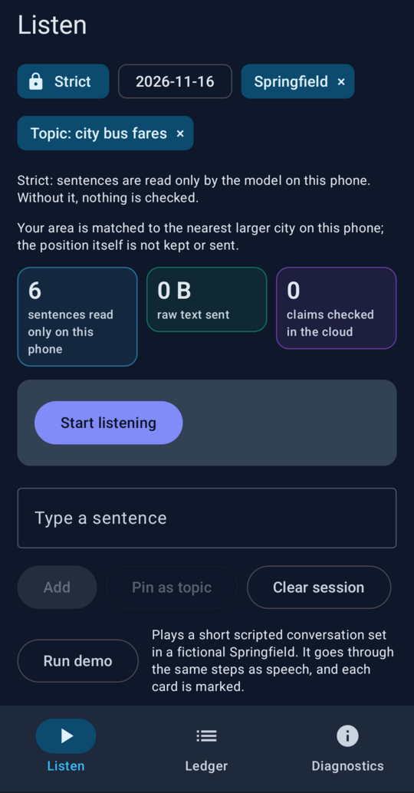
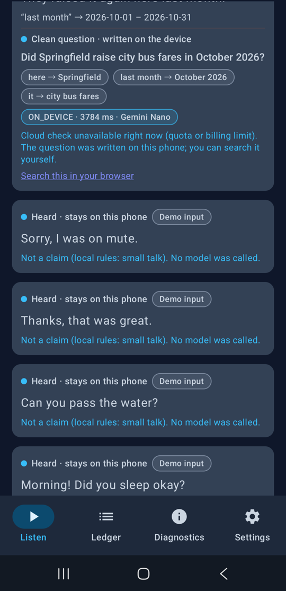
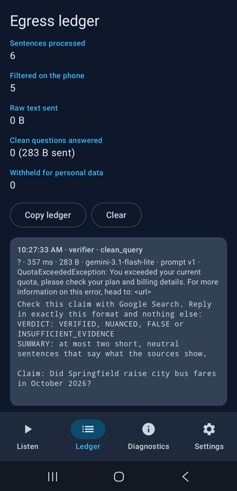

# ContextLens

<strong>Private, grounded fact checks for real conversations.</strong> The phone decides which sentences are checkable claims and rewrites them without personal data; only that clean question goes to the cloud for a sourced verdict.

AndroidFirebase AI LogicGemini Nano on deviceGrounding with Google SearchApp Check

!!! info "Status"
    Built for the [Firebase Hybrid AI Hackathon 2026](https://firebasehybridaihackathon.devpost.com/). Release 0.2.0 is the complete loop on Android, phone-only until you connect your own Firebase project ([download it](download.md)), and the same pipeline in Chrome on the [web companion](../). What exists today, and when it was built, is in the [progress log](implementation-progress.md); the on-device results are in [Evaluation](evaluation.md).

## The problem

Checking what is said in a meeting, a lecture or a conversation usually means sending the whole conversation to a server. Most of it is small talk, and the rest is full of names, places and phone numbers that do not need to leave the room.

## Three stages

| Stage | What happens | Where |
|---|---|---|
| 1. Local speech | the sentence, its resolved references ("here → Springfield") | on the phone |
| 2. Resolved question | one self-contained question without personal data | Gemini Nano on the phone |
| 3. Fact card | verdict, two neutral sentences, sources | cloud Gemini, grounded with Google Search |

Each card shows the source Firebase AI Logic reported for that request (on device or in cloud) and how long it took. See [how the hybrid split works](hybrid.md) and the [privacy firewall](privacy.md).

## On the phone

<figure><figcaption>Listen: Strict mode, the pinned topic and the session counters.</figcaption></figure>
<figure><figcaption>Cards from the demo: the clean question is written on the device; on a free-plan project the grounded check is refused, so the card offers a search. Small talk never reaches a model.</figcaption></figure>
<figure><figcaption>Ledger: everything that left the phone, word for word.</figcaption></figure>

## Get it

On Android: the signed APK from the newest release. In Chrome: the [web companion](../) runs the same three stages in the browser: the local rules and Gemini Nano in Chrome on the device, and the grounded check in a Firebase project you connect on the page ([setup](web-setup.md)). Without one, nothing leaves the browser. The same demo also runs in Chrome's side panel as a [Chrome extension](extension.md), installed with one command.

Scan with an Android phone to download the newest APK, or see [Download](download.md) for installing over USB.

- Source: [github.com/nikolareljin/context-lens](https://github.com/nikolareljin/context-lens)
